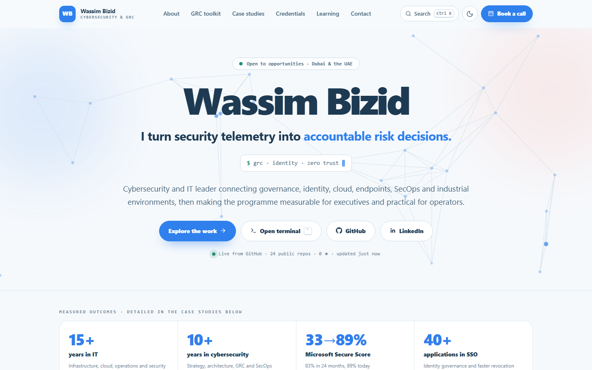
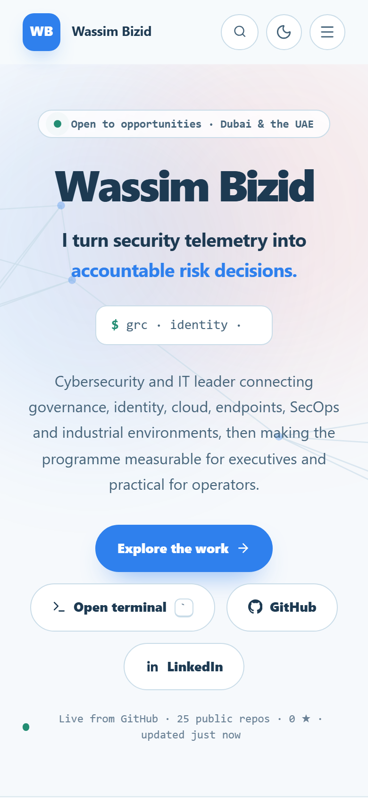

<div align="center">



[](https://bizidwassim-design.github.io/wassim-bizid-portfolio/)
[](https://github.com/bizidwassim-design/wassim-bizid-portfolio/actions/workflows/pages.yml)


</div>

## > whoami

Cybersecurity and GRC leader. This repository is the source of my interactive portfolio: 23 anonymised case
studies, 16 open-source GRC and SOC projects, credentials and a short story of how I work.

**Open it → [bizidwassim-design.github.io/wassim-bizid-portfolio](https://bizidwassim-design.github.io/wassim-bizid-portfolio/)**

<p align="center">
  
  
</p>

## > ls ~/features

| | |
|---|---|
| **Project explorer** | Search across 23 case studies, 12 topic filters, sort, grid or list view, deep links such as `#project-07` |
| **Command palette** | `Ctrl K` jumps to any section, project or link |
| **Terminal** | Press the backtick key: `help`, `whoami`, `ls`, `open`, `cat`, `stats`, `skills`, `certs`, `contact`, `theme`, `neofetch` |
| **Live GitHub stats** | Public repositories and stars read from the GitHub API, cached for 30 minutes |
| **Light and dark** | Follows the system theme, togglable, remembered |
| **Offline and installable** | Service worker plus web manifest |
| **Accessible** | Skip link, focus trap in dialogs, keyboard navigation everywhere, reduced-motion support |
| **Print friendly** | A clean CV-style print stylesheet |

## > cat ~/stack

Plain HTML, CSS and classic JavaScript. No framework, no bundler, no external fonts, no third-party scripts.
A strict Content Security Policy (`script-src 'self'; style-src 'self'`) is enforced by a meta tag, so the
code uses no inline scripts or styles.

```text
index.html          page shell
css/style.css       design system (tokens, light and dark themes)
js/core.js          rendering, explorer, dashboards, stats
js/overlays.js      drawer, lightbox, command palette, terminal
data/data.js        all content in one file
sw.js               offline cache
tools/check.mjs     integrity check: assets, icons, anchors, CSP
```

## > run ~/local

```bash
python -m http.server 8099
node tools/check.mjs
```

Open `http://localhost:8099`. Pushing to `main` deploys to GitHub Pages through
[`pages.yml`](.github/workflows/pages.yml).

## Notes

- Client names and sensitive details are removed from the case studies; dashboard values are illustrative.
- The page is marked `noindex`. Remove the robots meta tag in `index.html` to let search engines list it.
- Content is mine. Reuse the code freely, not the content or the photos.

## Contact

[LinkedIn](https://www.linkedin.com/in/wassim-bizid/) ·
[Book a 30-minute call](https://calendly.com/letstalk-today/30min)
