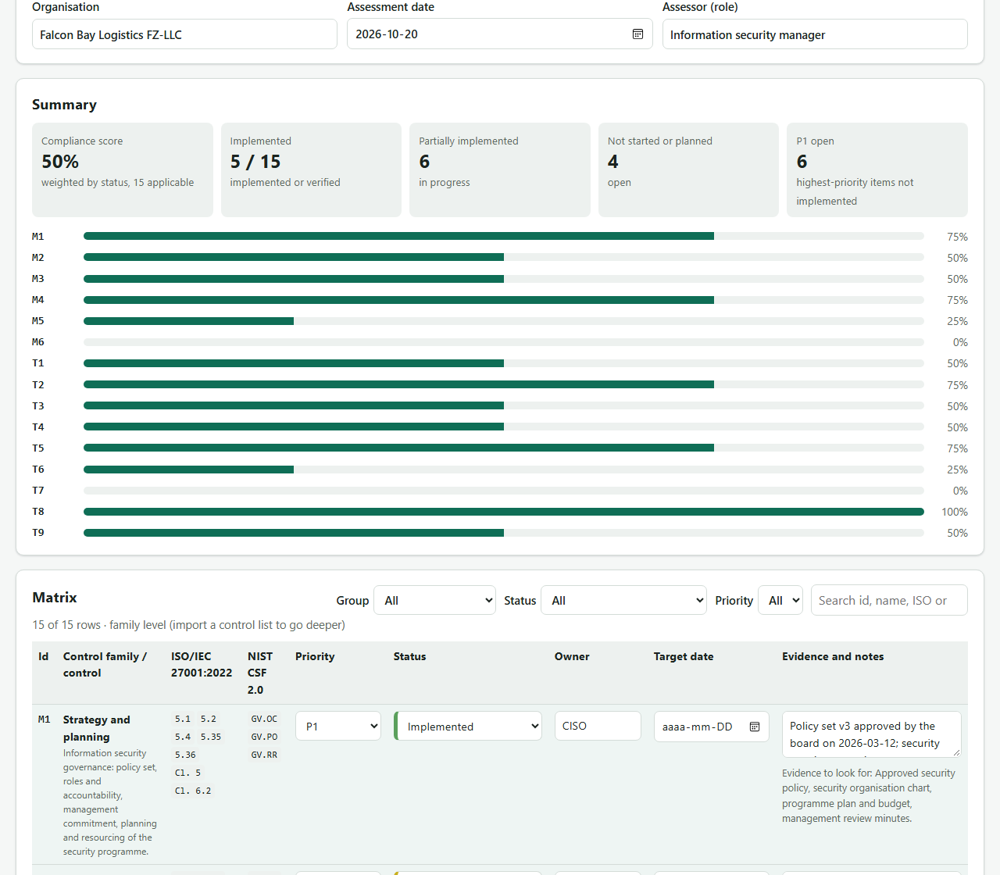

# UAE IA Compliance Matrix

[](LICENSE) [](https://bizidwassim-design.github.io/wassim-bizid-portfolio/uae-ia-matrix/) [](SECURITY.md)

A free, open-source **compliance matrix for the UAE Information Assurance (IA) Standard**: the 15 control families
(M1–M6 management, T1–T9 technical) with status, owner, target date and evidence per row, a compliance score,
per-family progress bars, a prioritised gap list, and mappings to **ISO/IEC 27001:2022** and **NIST CSF 2.0**.
One static page: no build, no server, no account, no telemetry. Open `index.html` and start.

**Live:** [bizidwassim-design.github.io/wassim-bizid-portfolio/uae-ia-matrix](https://bizidwassim-design.github.io/wassim-bizid-portfolio/uae-ia-matrix/)
(append `?sample=1` to open the fictional sample directly).



> 🇫🇷 Résumé en français en bas de page.

## Who it is for

Organisations in the UAE that must demonstrate alignment with the IA Standard, and teams that already run an
ISO 27001 or NIST CSF programme and need to show where the two overlap. The matrix is a working document for the
security manager and an evidence index for the assessor; it does not replace the official standard or an audit.

## Layout

This matrix lives in the `uae-ia-matrix/` folder of the [portfolio repository](https://github.com/bizidwassim-design/wassim-bizid-portfolio) and is published with it; its checks run in that repository's workflow.

```
index.html              the app (one page, strict Content-Security-Policy, no external resources)
assets/
  app.js                matrix rendering, scoring, filters, CSV/JSON export and import, draft storage, theme
  style.css             CSS tokens, light/dark theme, print stylesheet, system fonts
data/
  controls.js           the catalogue: 15 families with descriptions, ISO 27001 and NIST CSF mappings, evidence hints
  controls.csv          the same catalogue as CSV (generated)
  sample.js             fictional "Falcon Bay Logistics FZ-LLC" statuses used by the sample button and ?sample=1
templates/
  controls-import-template.csv   column layout for importing your own control list from the official standard
examples/
  falcon-bay-sample.json         a complete export in the app's JSON format (generated); use it to test Import
docs/
  framework-notes.md    what the standard covers, how the mappings were built, what to verify
  screenshot.png        what it looks like
scripts/
  check_controls.js     CI check: 15 families, 6 + 9 split, valid ISO and CSF references, complete sample
  build_data.js         regenerates data/controls.csv and examples/falcon-bay-sample.json
```

## Quick start

1. Open `index.html` (or the live page). Fill in the organisation, date and your role.
2. For each family pick a **status**, set the **priority** (P1–P4) and **owner**, add a **target date** for open
   items, and write the **evidence** you could show: a document name, a report, a screenshot reference.
3. Read the **summary**: compliance score, implemented count, open P1 items, one bar per family.
4. Work through **Gaps to close first**, ordered by priority then by status.
5. **Export JSON** to keep a dated record and re-import it later; **Export CSV** to work in Excel; **Print** for a
   clean PDF.

### Going control by control

The standard's individual controls are not reproduced here. To track them, list them from your copy of the
official document in the CSV layout of [`templates/controls-import-template.csv`](templates/controls-import-template.csv)
(`id,title,description,priority,iso27001,nist_csf`; separate several references with `;`) and use
**Import controls (CSV)**. Control ids such as `T5.2.1` are grouped under their family (`T5`), the family rows become
headings, and the score, bars and gap list switch to the imported controls. The controls are saved with the draft
and included in the JSON export.

## Scoring

| Status | Score |
|--------|-------|
| Not applicable | excluded |
| Not started | 0 |
| Planned | 1 |
| Partially implemented | 2 |
| Implemented | 3 |
| Implemented and verified | 4 |

* **Compliance score** = sum of scores ÷ (applicable items × 4), as a percentage.
* **Family bar** = the same calculation restricted to the family (or to the imported controls of that family).
* **Gap list** = applicable items scored below 3, ordered by priority (P1 first), then status, then id; the first 15.

## Mappings

Each family carries the ISO/IEC 27001:2022 Annex A controls (and management-system clauses) and the NIST CSF 2.0
categories that cover the same ground. They are this project's own reading, built at family level, and meant as
a starting point for a crosswalk, not as an authoritative mapping. [docs/framework-notes.md](docs/framework-notes.md)
explains the rules used and what to check against the official text.

## Export format

```json
{
  "schema": "uae-ia-compliance-matrix/1.0",
  "framework": "UAE Information Assurance Standard",
  "organisation": "Falcon Bay Logistics FZ-LLC",
  "assessment_date": "2026-10-20",
  "compliance_score": 50,
  "applicable": 15,
  "controls": [],
  "items": { "M1": { "status": "done", "priority": "P1", "owner": "CISO", "due": "", "evidence": "…" } }
}
```

Only `items` is required for import; unknown ids and statuses are ignored and reported.
See [examples/falcon-bay-sample.json](examples/falcon-bay-sample.json).

## Design choices

* **No framework, no bundler, no CDN.** One HTML file, one CSS file, three JS files.
* **Strict CSP** (`default-src 'none'`) in a meta tag: no inline scripts or styles, no network. CI fails if an
  external resource is introduced.
* **Catalogue as data.** `data/controls.js` is the single source of truth; the CSV and the sample export are
  generated and CI checks they are current.
* **Original wording.** Family names are the standard's; every description, mapping and evidence hint is written
  for this project. The standard's control text is never pasted; you import your own list.
* **Accessible by default:** native form controls with labels, sticky table header, skip link, focus styles,
  `aria-live` summary, light and dark themes with a manual override, print stylesheet.
* **Privacy:** the draft stays in `localStorage` (wrapped in `try/catch` for private browsing); the assessor field
  asks for a role, not a name.

## How it relates to the sibling repositories

| Repository | Relationship |
|------------|--------------|
| [grc-control-crosswalk](https://github.com/bizidwassim-design/grc-control-crosswalk) | The ISO 27001 → NIST CSF / CIS / SOC 2 crosswalk that extends each family's ISO references to other frameworks. |
| [iso27001-iso42001-toolkit](https://github.com/bizidwassim-design/iso27001-iso42001-toolkit) | Policies, Statement of Applicability and evidence list that produce the artefacts the evidence column asks for. |
| [control-evidence-collector](https://github.com/bizidwassim-design/control-evidence-collector) | Read-only scripts that collect hashed technical evidence for the T3, T4 and T5 families. |
| [risk-treatment-plan-generator](https://github.com/bizidwassim-design/risk-treatment-plan-generator) | Turns the gap list, once exported, into a wave-based treatment plan. |
| [ciso-executive-dashboard](https://github.com/bizidwassim-design/ciso-executive-dashboard) | Report the compliance score there as a trend KPI. |

## Contributing

Corrections to the mappings, Arabic or French labels, and accessibility fixes are welcome; see
[CONTRIBUTING.md](CONTRIBUTING.md) and the [Code of Conduct](CODE_OF_CONDUCT.md). Run
`node scripts/check_controls.js` and `node scripts/build_data.js` before opening a pull request.

## Disclaimer

This tool is an independent, community project. It is not affiliated with, endorsed by or derived from any
UAE authority. Family names are used to identify the standard's structure; the official standard, its control
text and any assessment obligation are defined by the issuing authority. Use the matrix to organise your work
and your evidence; it does not replace the standard, an accredited assessment or professional advice. All sample
data is fictional.

## License

[MIT](LICENSE): free to use, copy, modify and redistribute.

---

## 🇫🇷 Résumé

Matrice de conformité **open source pour la norme UAE Information Assurance** : les 15 familles de contrôles
(M1–M6 management, T1–T9 techniques) avec statut, responsable, échéance et preuves par ligne, score de conformité,
barres de progression par famille, liste des écarts priorisés, et correspondances avec ISO/IEC 27001:2022 et
NIST CSF 2.0. Page web statique sans serveur ni dépendance ; import de votre propre liste de contrôles (CSV),
export JSON et CSV, impression, brouillon conservé dans le navigateur. Les données d'exemple (« Falcon Bay
Logistics ») sont fictives. Licence MIT.
